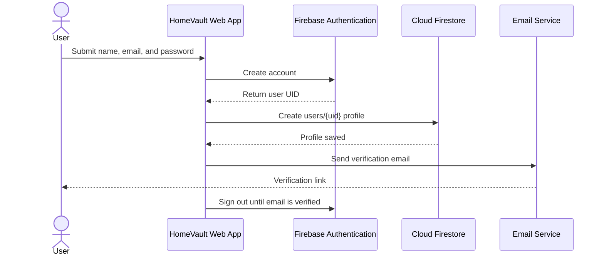
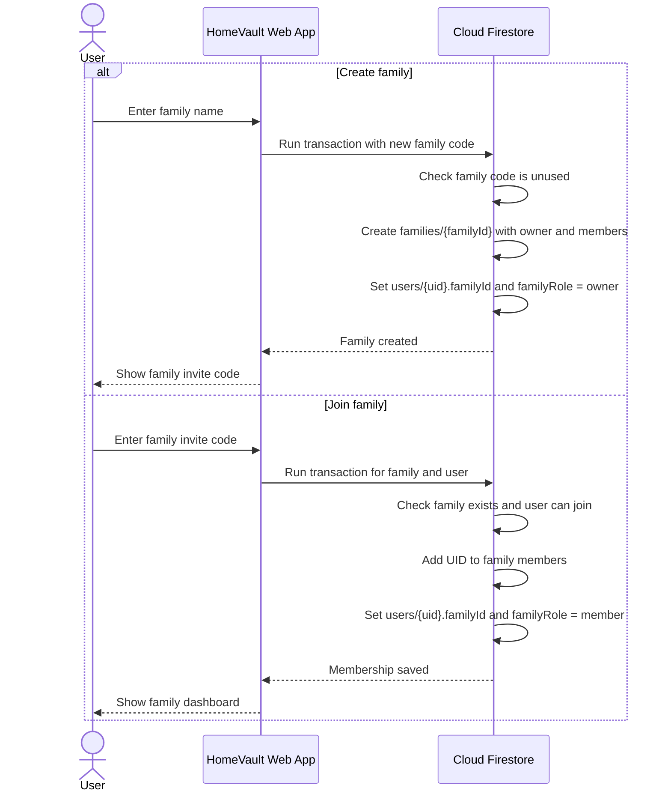
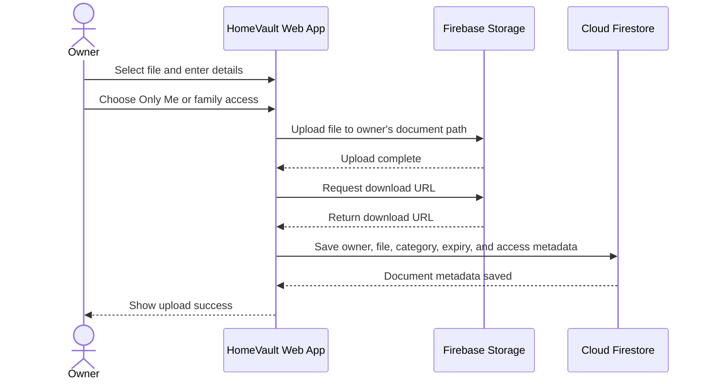
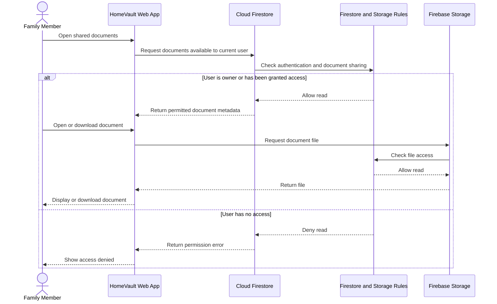
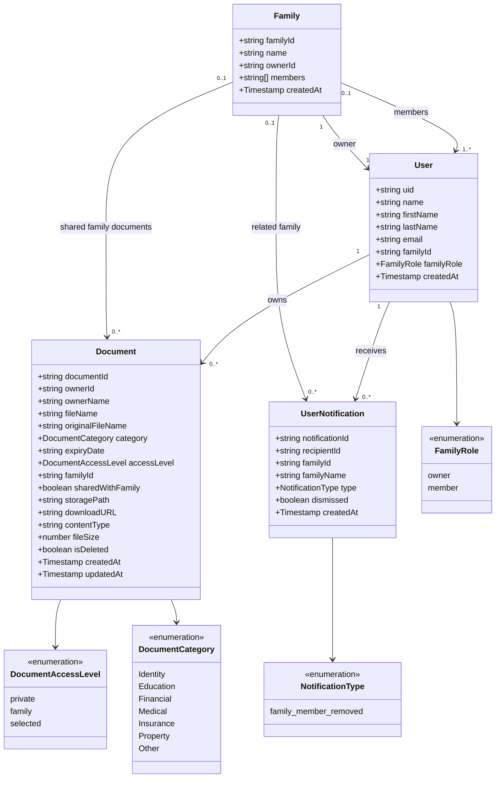
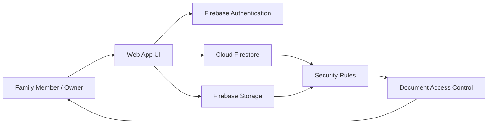
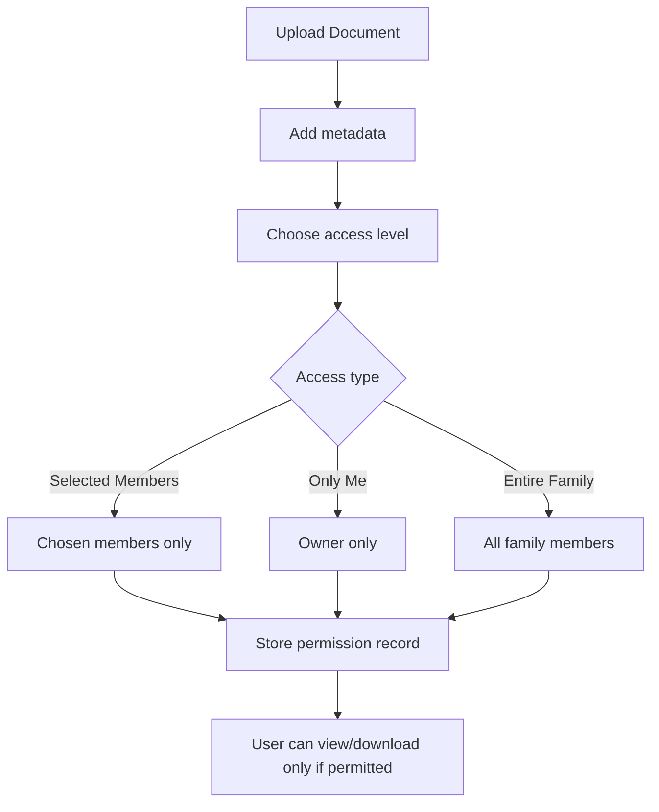

# HomeVault Diagrams

## Sequence diagrams

The diagrams below describe the main HomeVault MVP interactions. They show the
intended access-control checks for document sharing; document Firestore and
Storage rules still need to be implemented before shared-document access is
securely enforced.

### User registration

### Create or join a family

### Upload a document

### View a shared document

## Class diagram

This domain class diagram reflects the current Firestore data model and the
relationships used by HomeVault.

`familyId` is optional for a document because private documents are not linked
to a family. The `selected` access level is present in the upload options, but
the current document record does not yet store the selected member IDs.

## High-level architecture

## Core document-sharing flow

## Planned MVP screens

- Landing page
- Login page
- Sign up page
- Dashboard
- My Documents view
- Family members view
- Shared documents view
- Upload document form
- Document detail and permission panel

## Notes

These diagrams are intended to support system understanding and guide the Firebase data model and permission design for the MVP.
